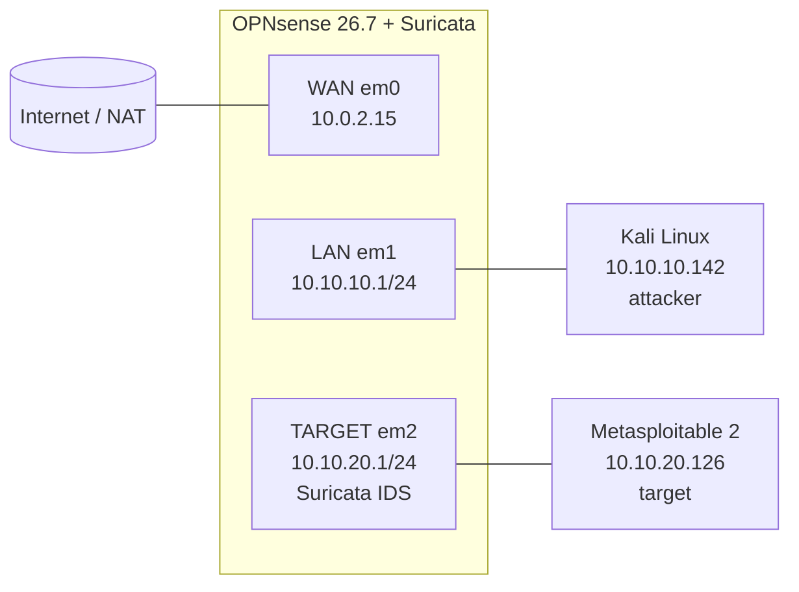
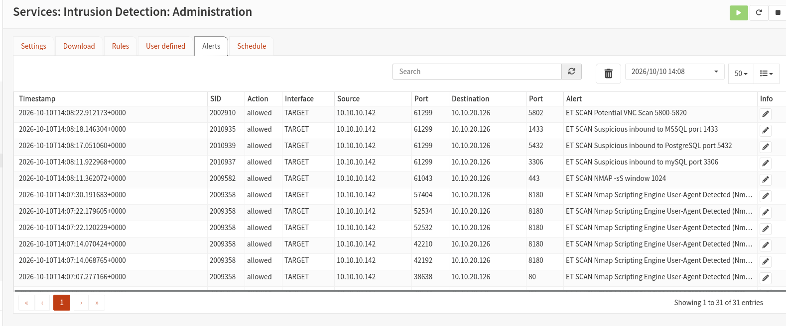
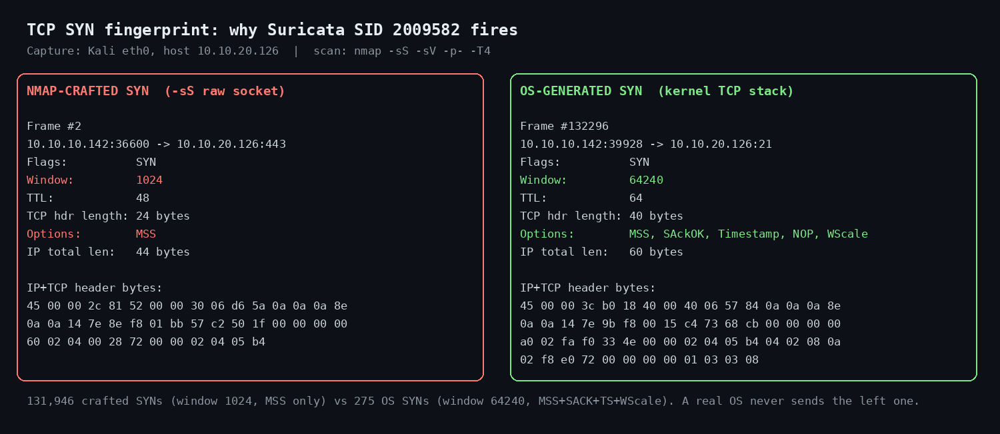

# Detecting Nmap Scans with Suricata in an Isolated Homelab

A segmented VirtualBox lab where an attacker (Kali) scans a deliberately vulnerable target (Metasploitable 2) through an OPNsense firewall, and Suricata in IDS mode on the target segment detects the reconnaissance. The scan is then verified packet by packet in Wireshark.

**Skills shown:** network segmentation, firewall rules, DHCP, IDS configuration and rule tuning, active reconnaissance, packet analysis, and mapping alerts to the traffic that triggered them.

---

## Topology



| Segment | VirtualBox network | Subnet | Host |
|---|---|---|---|
| WAN | NAT | 10.0.2.0/24 | OPNsense uplink |
| LAN (attack) | internal `lab-attack` | 10.10.10.0/24 | Kali, 10.10.10.142 |
| TARGET | internal `lab-target` | 10.10.20.0/24 | Metasploitable 2, 10.10.20.126 |

Both lab networks are VirtualBox *internal* networks. The only path between them, or out to the internet, goes through OPNsense.

---

## 1. Segmentation and isolation

- **DHCP:** Dnsmasq on OPNsense serves `.100–.200` on both lab segments.
- **Firewall on TARGET:** default **block + log**. The only exception is DHCP (UDP 67) so the target can get a lease.
- **Result:**
  - Kali → target: reachable.
  - Target → Kali: blocked.
  - Target → internet: blocked.

  A compromised target therefore cannot call back or reach anything outside its own segment.

## 2. Reconnaissance

From Kali:

```bash
sudo nmap -sS -sV -p- -T4 10.10.20.126
```

**29 open TCP ports** were found, including:

| Category | Ports |
|---|---|
| Remote access | 21 ftp, 22 ssh, 23 telnet, 512–514 r-services, 5900 vnc, 6000 X11 |
| Mail and DNS | 25 smtp, 53 domain |
| Web | 80 http, 8180 http (Tomcat) |
| File sharing and RPC | 111 rpcbind, 139/445 SMB, 2049 nfs, 2121 ftp |
| Databases | 3306 mysql, 5432 postgresql |
| Other | 1099 java-rmi, 1524 bindshell, 3632 distccd, 6667/6697 irc, 8787 drb (Ruby) |
| Dynamic | 4 ephemeral ports used by RPC services |

## 3. IDS configuration (Suricata on OPNsense)

| Setting | Value | Why |
|---|---|---|
| Mode | PCAP live (IDS) | Alert only, no blocking. Works on virtual NICs |
| Interface | TARGET | Sees real source and destination IPs. On WAN everything would be hidden behind NAT |
| `HOME_NET` | `10.10.20.0/24` | See pitfall below |
| Ruleset | ET Open, `emerging-scan` only | Keeps the VM light |
| Extra rule enabled | SID 2009582 (`ET SCAN NMAP -sS window 1024`) | Disabled by default in this ruleset |
| NIC offloading | CRC, TSO and LRO disabled | Offloading can hide or merge packets so the IDS never sees them |

**Pitfall: `HOME_NET`.** ET rules match `$EXTERNAL_NET → $HOME_NET`. By default `HOME_NET` contains all RFC 1918 ranges, so both the attacker (10.10.10.0/24) and the target count as "home". In that case the scan rules never fire. Narrowing `HOME_NET` to the target subnet makes the attacker count as external.

## 4. Detection results

A full scan produced **31 alerts**, all on TARGET, all from 10.10.10.142 to 10.10.20.126, all with action `allowed` (IDS mode). They fall into three layers of detection:

| Layer | SID | Signature | What it catches |
|---|---|---|---|
| **Packet signature** | 2009582 | ET SCAN NMAP -sS window 1024 | A raw SYN crafted by Nmap, not by an OS TCP stack |
| **Behaviour** | 2010935 | ET SCAN Suspicious inbound to MSSQL port 1433 | Probing of database and remote-desktop ports a normal client would not touch |
| | 2010937 | ET SCAN Suspicious inbound to mySQL port 3306 | |
| | 2010939 | ET SCAN Suspicious inbound to PostgreSQL port 5432 | |
| | 2002910 | ET SCAN Potential VNC Scan 5800-5820 | |
| **Application layer** | 2009358 | ET SCAN Nmap Scripting Engine User-Agent Detected | HTTP requests from the `-sV` / NSE phase announcing themselves as Nmap |



## 5. Packet analysis (Wireshark)

The capture was taken on Kali `eth0` with filter `host 10.10.20.126`.

| Metric | Value |
|---|---|
| Packets / duration | 266,222 packets in 324 s (two full `-p-` passes) |
| Nmap-crafted SYNs | **131,946**: window **1024**, single option MSS 1460 |
| OS-generated SYNs | 275: window 64240, MSS + SACK + Timestamps + WScale (the `-sV` connect phase) |
| Source ports | Each SYN pass used **one fixed source port** (36856 and 61299). These are the same ports seen in the Suricata alerts |
| Target replies | 131,957 RST (closed) and SYN-ACK from 29 open ports |
| HTTP User-Agent | `Mozilla/5.0 (compatible; Nmap Scripting Engine; https://nmap.org/book/nse.html)`, 9 requests |

Filter to isolate the raw scan packets:

```
tcp.flags.syn==1 && tcp.flags.ack==0 && tcp.window_size_value==1024
```

Side-by-side view of a crafted Nmap SYN and an OS-generated SYN:



A real OS never sends a SYN with a 1024-byte window and no SACK or timestamps. That fingerprint is exactly what SID 2009582 matches.

## 6. Takeaways

- **Detection depends on context.** The same rules were completely silent until `HOME_NET` matched the actual network design.
- **Defence in depth works even for recon.** One scan was caught three independent ways: packet shape, port behaviour and application payload. Evading one (e.g. changing the window size) would still trigger the others.
- **`-sS` is not stealthy against an IDS.** Half-open scanning avoids application logs, but its packets are trivially fingerprintable.
- **IDS ≠ IPS.** Every alert was `allowed`. Blocking would need inline IPS mode or a firewall rule driven by the alerts.

## 7. Next steps

- [ ] Switch Suricata to IPS (netmap inline) and measure what gets dropped.
- [ ] Try evasion (`--scan-delay`, `-f` fragmentation, custom window size) and record which rules still fire.
- [ ] Forward OPNsense and Suricata logs to a SIEM (Wazuh or ELK) and build a scan-detection dashboard.
- [ ] Exploit one service on Metasploitable and write the matching detection.

---

## Repository layout

```
.
├── README.md
├── images/
│   ├── topology.png
│   ├── suricata-alerts.png
│   └── syn-comparison.png
├── captures/
│   └── scan.pcapng
└── scans/
    └── scan_full.txt
```

*Everything in this repo was run against my own isolated lab. Do not scan systems you do not own or are not authorised to test.*
